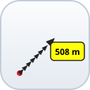

# Interactive Ruler for QGIS

An interactive measuring tool for QGIS 3.x. Draw a straight line or a
multi-point path on the map, and the plugin saves it as a styled ruler
layer with direction arrows and a length label.



## Features

- **One toolbar button** opens a compact launcher dialog.
- **Straight line mode (I-Ruler)**: drag from start to end.
- **Path mode (I-Ruler Path)**: click each point and finish the path.
- **Live distance balloon** next to the cursor while dragging.
- **Layer name box**: measurements are grouped under the name you type
  and every finished line or path becomes its own layer named after its
  result, for example `SITE C 1.82 km`.
- **Automatic units**: metres below 1 km, kilometres above.
- **Arrow line style** with length labels, created in code so no style
  file is required.
- **Font size and line width sliders** for new or existing ruler layers.
- **Three colour themes** chosen in a small popup after each finished
  measurement: Dark (black), Light (white) and Red (`#e31a1c`).
- **Always-red drag preview**, visible on both light and dark basemaps.
- **Per-layer styling**: each saved ruler keeps its own theme, font size
  and line width.
- **No-CRS warning**: the plugin refuses to measure until the project has
  a CRS, instead of reporting a meaningless length.

## Requirements

- QGIS 3.0 or newer.

## Installation

Install it from the QGIS **Plugin Manager** (*Plugins > Manage and Install
Plugins*), or manually from this repository:

1. Download the plugin ZIP, or clone this repository.
2. Copy the plugin folder into your QGIS profile:

   ```text
   Windows: %APPDATA%\QGIS\QGIS3\profiles\default\python\plugins\
   Linux:   ~/.local/share/QGIS/QGIS3/profiles/default/python/plugins/
   macOS:   ~/Library/Application Support/QGIS/QGIS3/profiles/default/python/plugins/
   ```

3. Enable **Interactive Ruler** in *Plugins > Manage and Install Plugins >
   Installed*.
4. The ruler button appears on the toolbar.

## Usage

1. Click the ruler toolbar button.
2. Type a layer name (for example the site name) and choose the measuring
   mode.
3. Draw on the map:
   - **I-Ruler**: press, drag and release.
   - **I-Ruler Path**: click each point, then double-click or press Enter
     to finish.
4. Pick the theme for the finished line in the popup. The last choice is
   pre-selected, so pressing Enter accepts it.
5. The measurement is saved in its own layer with a length label.

Font size and line width can be changed before drawing to set the default
for new measurements, or with a ruler layer/group selected in the Layers
panel to restyle existing lines. Existing lines are never recoloured;
draw them again to change the colour.

## Settings

The plugin stores its last-used settings in the QGIS profile, in
`QGIS3.ini`:

```ini
[interactive_ruler]
layer_name=...
theme=...
label_font_size=...
line_width=...
```

The built-in default layer name is `Ruler`. Remove the section or edit the
values to reset the plugin without affecting the rest of QGIS.

## Documentation

- [User manual (PDF)](Interactive-Ruler-User-Manual.pdf)

The manual covers installation, the launcher dialog, measuring, styling,
the settings reference and troubleshooting.

## Files

| File | Purpose |
| --- | --- |
| `__init__.py` | QGIS plugin entry point |
| `interactive_ruler.py` | Plugin implementation |
| `metadata.txt` | Plugin metadata and changelog |
| `icon.svg` | Toolbar icon |
| `icon.png` | Raster version of the icon |
| `LICENSE` | GNU General Public License v2.0 |
| `Interactive-Ruler-User-Manual.pdf` | User manual with table of contents |

## Version

Current version: **1.18**

- **1.18** – Qt6 compatibility fixes: scoped enum names, `exec()` instead
  of `exec_()`, and `QVariant` imported from `qgis.PyQt`. No behaviour
  change.
- **1.17** – Added the Red theme (`#e31a1c`); the drag preview is now
  always red so it stays visible with the Light theme.
- **1.16** – Warns and refuses to measure when the project has no CRS.
- **1.15** – Safe handling of ruler layers deleted outside the plugin.

See `metadata.txt` for the full changelog.

## Author

hafiz m.

## License

Copyright (C) 2026 hafiz m.

This plugin is free software: you can redistribute it and/or modify it
under the terms of the GNU General Public License as published by the Free
Software Foundation, either version 2 of the License, or (at your option)
any later version.

See [LICENSE](LICENSE) for the full text.
